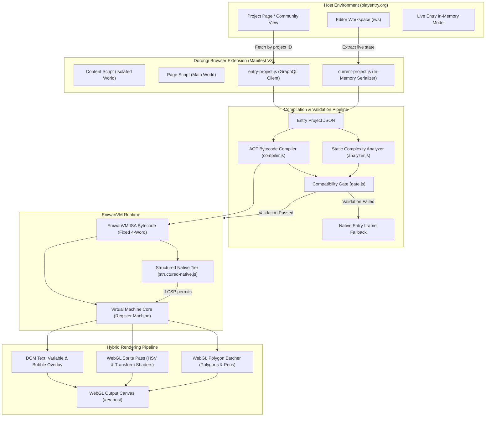
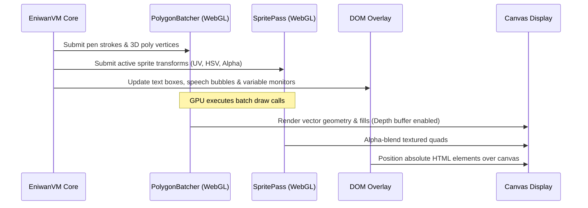

# Dorongi (EniwanVM) Technical Architecture

This document describes the internal architecture, compiler pipeline, virtual machine execution engine, rendering pipeline, and security model of **Dorongi v4.0.0**.

---

## 1. High-Level Architecture Overview

Dorongi replaces the standard EntryJS runtime on `playentry.org` with an Ahead-of-Time (AOT) compiled bytecode virtual machine and a custom WebGL batch renderer.

---

## 2. In-Memory Workspace Snapshotting (`current-project.js`)

In the Entry block editor (`playentry.org/ws`), running projects normally requires server persistence or standard exports. Dorongi integrates directly with the live editor state:

1. **Non-destructive Inspection**: Instead of invoking `Entry.exportProject()` (which interrupts execution and triggers modal exports), Dorongi reads the live in-memory state of `Entry.container.getAllObjects()`, `Entry.scene.getScenes()`, `Entry.variableContainer`, and `Entry.dataTable`.
2. **Deterministic Serialization**: Block trees, custom functions (`Entry.variableContainer.functions_`), entity transformations, and initial variables are deep-cloned into an Entry Project JSON schema compatible with the compiler.
3. **Instant Hot Reloading**: Unsaved block changes run instantly without network roundtrips or GraphQL synchronization.

---

## 3. Static Analysis & Complexity Classification (`analyzer.js`)

Before emitting machine instructions, `analyzer.js` traverses the block syntax tree to calculate deterministic complexity metrics:

- `tickCost`: Estimated arithmetic and flow-control operation count per logic tick.
- `penPerTick`: Frequency of pen drawing and polygon rasterization blocks.
- `fillPerTick`: Complex polygon fill frequencies.
- `cloneCount`: Dynamic entity cloning triggers.

### Execution Tier Classification

Based on these metrics, projects are classified into runtime tiers:
- **Tier 1 (Basic / Lightweight)**: Simple sprite animations, narrative games, low draw-call workloads.
- **Tier 2 (Moderate / Simulation)**: Multi-threaded games with frequent clone updates and math computations.
- **Tier 3 (High-Density / 3D Engine)**: Raycasters, 3D wireframe engines, soft-body physics, and heavy pen-fill math routines.

---

## 4. Compilation Pipeline & EniwanVM ISA (`compiler.js`, `isa.js`)

Dorongi does not interpret Entry block trees dynamically. It compiles block hierarchies ahead-of-time into a flat instruction array using a register machine model.

### 4.1 Instruction Format

Instructions in `isa.js` are encoded as fixed-width 4-word tuples `[op, a, b, c]`:
- `op`: 8-bit Opcode identifier.
- `a`: Destination register or primary operand.
- `b`: Source register 1 or immediate parameter.
- `c`: Source register 2 or auxiliary parameter.

### 4.2 Key Opcode Categories

| Category | Opcodes | Description |
|---|---|---|
| **Register & Stack** | `MOV`, `LOAD_CONST`, `PUSH`, `POP` | Move register values, load literals, push/pop call frames. |
| **Arithmetic & Logic** | `ADD`, `SUB`, `MUL`, `DIV`, `MOD`, `POW`, `AND`, `OR`, `NOT`, `CMP_EQ`, `CMP_LT`, `CMP_GT` | Low-overhead scalar and boolean arithmetic. |
| **Control Flow** | `JMP`, `JMP_IF_TRUE`, `JMP_IF_FALSE`, `CALL`, `RET`, `YIELD` | Conditional branching, function invocation, cooperative tick yielding. |
| **Transform & State** | `SET_X`, `SET_Y`, `SET_ROTATION`, `SET_SIZE`, `SHOW`, `HIDE` | Entity spatial transformations and visibility states. |
| **Vector & Graphics** | `PEN_DOWN`, `PEN_UP`, `PEN_COLOR`, `PEN_SIZE`, `DRAW_POLY`, `FILL_POLY` | Vector stroke commands and batched polygon submissions. |
| **I/O & Entity** | `KEY_DOWN`, `MOUSE_X`, `MOUSE_Y`, `CLONE_CREATE`, `CLONE_DELETE`, `BROADCAST` | User input querying, clone lifecycle, message broadcasting. |

### 4.3 Compiler Optimizations

1. **Constant Folding**: Pure mathematical operations with literal operands (e.g., `(10 * 3.14159) / 2`) are evaluated at compile time.
2. **Dead Block Elimination**: Orphaned blocks not attached to an execution root (`when_run_button_click`, `when_key_pressed`, `when_message_cast`, etc.) are stripped.
3. **Register Reuse**: Temporary registers are allocated with live-range analysis to minimize register file pressure.
4. **Cooperative Yield Minimization**: Consecutive arithmetic blocks do not yield; yields are inserted selectively at loop boundaries and explicit wait blocks.

---

## 5. Execution Tiers: Bytecode Interpreter vs. Native JIT

EniwanVM employs a dual-tier execution architecture:

### Tier 1: Bytecode Register Machine
The default execution tier runs the 4-word ISA loop. It eliminates per-tick object allocations, maintaining flat typed arrays for registers, entity states, and call stacks.

### Tier 2: Structured Native JIT Tier (`structured-native.js`)
For computationally heavy custom functions (such as matrix multiplication, 3D vertex projection, or recursive fractals), the compiler attempts to emit direct JavaScript functions:
- **Condition for JIT**: The function must consist solely of arithmetic, local variable mutations, scalar array indexing, and structured loops without DOM or async side-effects.
- **Safety & CSP Fallback**: If strict Content Security Policy (`script-src`) headers prohibit dynamic function construction (`new Function()`), the runtime catches the security exception gracefully and continues execution in the Bytecode Register Machine tier without interrupting the user.

---

## 6. Hybrid Rendering Pipeline

Rather than relying on DOM elements or CPU-bound 2D Canvas rendering for every entity, Dorongi separates vector operations and sprite passes into dedicated WebGL pipelines.

### 6.1 WebGL Polygon Batcher (`polygon-batcher.js`)
- **Dynamic Vertex Buffering**: Combines thousands of line segments and polygon triangles into unified vertex buffers per frame to eliminate draw-call overhead.
- **Depth Buffering**: Enables z-depth testing for 3D polygon renderers, eliminating manual painters-algorithm sorting overhead on the CPU.

### 6.2 WebGL Sprite Pass (`sprite-pass.js`)
- **Custom Shader Transformations**: Applies sprite positioning, rotation, scale, brightness, alpha transparency, and HSV color filtering directly in fragment shaders.
- **Pre-fetched Asset Caching**: Sprites hosted on the official Entry CDN (`/uploads/...`) are loaded into WebGL texture units.

### 6.3 DOM Overlay (`page/player.js`)
- **Text Boxes & Dialogue**: Entry text elements, speech bubbles, and variable monitors are rendered via an overlay DOM layer positioned above the WebGL canvas, preserving native typography rendering and sharp text scaling.

---

## 7. Decoupled Logic & Render Loop

In standard EntryJS, logic execution and visual rendering are coupled within the browser's display cycle. Dorongi decouples these two timing domains:

- **Logic Loop (`logicHz`)**:
  - Configurable rates: `30 Hz`, `60 Hz` (default), `120 Hz`, `240 Hz`, or `Unlimited`.
  - Driven by fixed-timestep accumulation using `performance.now()`.
  - Guarantees physics and state updates remain deterministic regardless of display refresh rates.
- **Render Loop (`renderHz`)**:
  - Configurable rates: `30 Hz`, `60 Hz`, `120 Hz`, `144 Hz`, `240 Hz`, or `Display VSync` (`requestAnimationFrame`).
  - Interpolates visual transforms between logic updates for ultra-smooth rendering on high-refresh monitors.
- **Turbo Mode**:
  - Configurable multiplier: `1x`, `2x`, `4x`, `8x`, or `Uncapped`.
  - Expands the per-tick instruction execution budget, executing non-yielding loops without artificial delays.

---

## 8. Compatibility Gate & Fallback Engine (`gate.js`)

Dorongi guarantees visual and functional safety through a strict pre-flight gate. If an Entry project uses features outside Dorongi's current execution engine, it transparently yields control back to the native EntryJS runtime:

| Failure Code | Root Cause | Fallback Behavior |
|---|---|---|
| `no-draw` | Project contains neither vector pen blocks nor loadable costumes. | Reverts to native Entry iframe; displays diagnostic badge. |
| `local-picture` | Project references local/un-uploaded image assets unavailable on Entry CDN. | Reverts to native Entry iframe; displays diagnostic badge. |
| `unsupported` | Project utilizes blocks currently unsupported by the compiler (e.g., hardware sensors, AI vision). | Reverts to native Entry iframe (can be overridden via popup). |
| `no-thread` | Project contains no runnable entry points (`when_run_button_click`, etc.). | Reverts to native Entry iframe. |

---

## 9. Security Model & Isolation Boundaries

Because Dorongi runs with extension privileges on `playentry.org`, rigorous defense-in-depth principles are enforced across all execution boundaries:

1. **Manifest V3 Least Privilege**:
   - `permissions`: Only `storage` (for user preferences such as FPS and turbo settings).
   - `host_permissions`: Strictly limited to `https://playentry.org/*`. No arbitrary network access.
2. **Strict Origin Validation**:
   - All inter-world communication (`content.js` ↔ `page/*.js`) validates `event.source === window` **and** `event.origin === location.origin`.
   - `chrome.runtime.onMessage` explicitly verifies `sender.id === chrome.runtime.id` to prevent cross-extension message forging.
3. **Rigorous Input Sanitization**:
   - Numeric settings (`logicHz`, `renderHz`, `turbo`) are clamped against strict finite whitelist arrays. Arbitrary payloads (e.g. `1e9`) are rejected.
   - Telemetry statistics transmitted to the popup are filtered through `sanitizeStats`, preventing prototype poisoning or memory leaks.
4. **Restricted Dynamic Code Generation**:
   - `eval`, `document.write`, and string-based `setTimeout` are strictly prohibited.
   - Dynamic JIT compilation in `structured-native.js` is isolated and only accepts validated numeric opcodes and JSON-encoded numeric literals.
